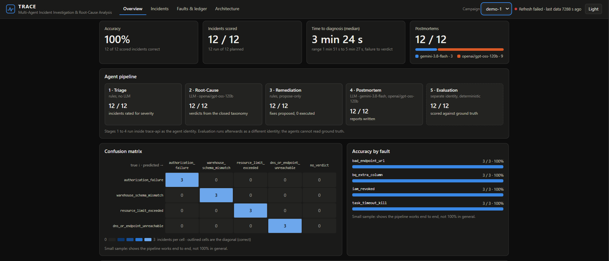
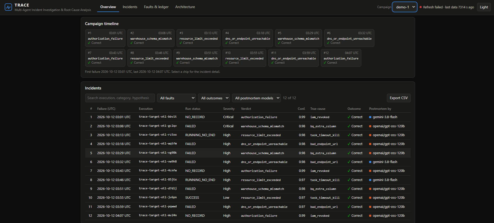

# TRACE

**Triage and Root-cause Analysis with Coordinated Evaluation agents**
*Multi-Agent Incident Investigation & Root-Cause Analysis System*

TRACE watches a real, scheduled data pipeline, deliberately breaks it in controlled ways, and uses a team of AI agents
(Triage, Root-Cause, Remediation, Postmortem, Evaluation) to diagnose each failure. Because every fault is injected on
purpose, the true cause is known, so diagnostic accuracy is a **measured number**, not a claim.

> **Status (2026-10-12):** the demo scope is built and deployed: the target pipeline, four injectable faults with an
> automatic reverter, the agents, the evaluator, a campaign runner and a private dashboard. Two recorded campaigns have
> been scored. Several parts of the wider design are designed but not built; they are listed under
> [Designed, not built](#designed-not-built).

## How it works

```
[Cloud Run Job: target ETL] --> BigQuery (hourly air-quality data, run ledger)
            ^        |
            |        +--> Cloud Logging (the agents read a restricted view of it)
 [Maintenance runner] changes the job, the dataset permissions or the table, and always reverts
            |
            +--> ground truth (restricted dataset)

 [Campaign runner] --failed execution name--> [Agents on Cloud Run]
                                               Triage -> Root-Cause -> Remediation -> Postmortem
 [Evaluator] compares verdicts with ground truth --> accuracy and a confusion matrix --> dashboard
```

- **Target system:** an hourly air-quality ETL for 36 Indian states and union territories, loading into BigQuery.
- **Fault injection:** four reversible, cloud-native faults: revoked write permission, an extra table column, a task
  timeout of a few seconds, and an unreachable source URL. Each is written to the ground-truth ledger before it is
  injected, and a scheduled reverter restores the target even if the injector crashes.
- **Agents:** a LangGraph graph of four stages. Triage and Remediation are rule-based; only Root-Cause and Postmortem
  call a language model. Root-Cause must answer from a closed four-category taxonomy, so accuracy is a deterministic
  equality check, never a model's opinion.
- **Propose-only remediation:** agents suggest fixes and never execute them. This is enforced by IAM, not by prompt.
- **Evaluation integrity:** ground truth lives in a separate dataset the agent identity cannot read. Scoring runs
  afterwards under a different identity.
- **One campaign runner:** inject, run the job, call the agents, revert, score, using a different identity for each
  step. The list of injections is fixed from a logged seed before the first one, and every incident is scored.

## Results so far

| Campaign | Planned | Run and scored | Correct |
|---|---|---|---|
| `demo-1` | 12 (3 of each fault) | 12 | 12 |
| `demo-2` | 12 | 4 | 4 |

Read these as "the pipeline works end to end", not as a general accuracy:

- The sample is small: 16 incidents in total, and `demo-2` stopped after 4 of its 12.
- The four faults were measured beforehand to leave clearly different traces, and the four categories were written
  after those measurements. The classification task is therefore easy by construction.
- Both campaigns draw fault parameters from the same small pool, so `demo-2` is a repeat, not a harder test.
- No run without a fault, no fault outside the taxonomy and no ablation has been evaluated.

## Dashboard

`trace-dashboard` is a read-only page over the evaluation results of a recorded campaign. It reads three BigQuery
views and nothing else; it cannot inject faults, run the pipeline or change anything.

- **Overview:** accuracy, incidents scored, time to diagnosis and the postmortem model split; the agent pipeline
  (Triage, Root-Cause, Remediation, Postmortem, Evaluation); the confusion matrix; accuracy by fault; a campaign timeline;
  and the incidents table with filters and CSV export.
- **Incident detail:** selecting an incident opens a drawer with the verdict and confidence, the ground truth (visible to
  the evaluator side only, never to the agents), the evidence the agent saw, its hypothesis, the proposed remediation
  (never executed) and the postmortem.
- **Faults & ledger, Architecture:** the fault catalog with the injection ledger, and the components with what each
  identity can and cannot read. Parts that are designed but not built are labelled as such.





Both screenshots show campaign `demo-1`. The numbers come from a small recorded campaign: they show that the pipeline
works end to end, not a general accuracy.

### Access

The service is private: it has no public URL access and no login page of its own. Cloud Run IAM decides who may call it,
and the only invoker is the project owner. To open it, run this in Cloud Shell as that account and then use Web Preview
on port 8080:

```
gcloud run services proxy trace-dashboard --region us-central1 --port 8080
```

An unauthenticated request to the service URL returns 403.

## Design constraints

- Runs entirely on Google Cloud's free tier (Cloud Run, BigQuery, Cloud Scheduler, Cloud Logging, Artifact Registry,
  Secret Manager), from Cloud Shell and GitHub Actions. Nothing runs on a laptop.
- BigQuery is the only database.
- No secrets in git and no service-account keys: Secret Manager and Workload Identity Federation only.

## Designed, not built

- Automatic detection: log sink to Pub/Sub trigger and a freshness watchdog. Today the campaign runner calls the agents.
- An upstream gateway and the faults that need it (slow upstream, rate limiting, upstream schema drift, partial data).
- A fault outside the taxonomy, the `unknown` category and control runs with no fault.
- Embedding memory of past incidents and the memory on/off ablation.
- A reduced-evidence ablation (re-running Root-Cause without the log excerpt). Estimated only.
- A read-only MCP server.

## Roadmap

| Phase | Scope | State |
|---|---|---|
| 0 | Cloud workspace and guardrails | done |
| 1 | Target ETL as a Cloud Run job | done; the schedule is paused |
| 2 | Detection and incident ledger | designed, not built |
| 3 | Fault injector and ground truth | done for four faults |
| 4 | Agents and orchestrator | done |
| 5 | Evaluation and campaigns | done; two recorded campaigns |
| 6 | Dashboard and read-only MCP access | dashboard done (private); MCP designed |
| 7 | Hardening and release | not started |

## Data attribution

Air-quality data comes from the [Open-Meteo Air Quality API](https://open-meteo.com/), which is based on CAMS
(Copernicus Atmosphere Monitoring Service) data.

## License

No license file is provided. All rights reserved.
